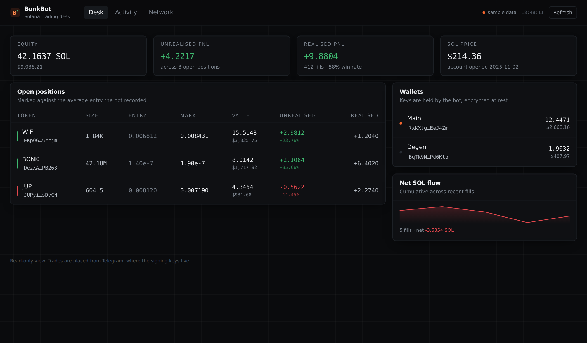
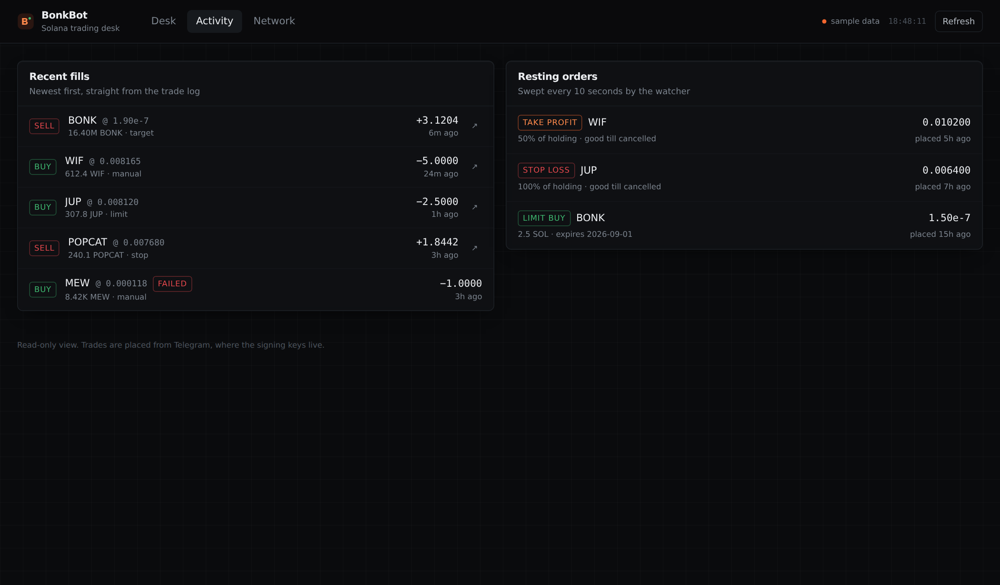

# BonkBot

A Telegram trading bot for Solana. Paste a mint address into a chat, pick a
size, and the swap is routed through Jupiter and signed by a wallet the bot
holds for you. Positions, PnL and resting limit orders are tracked server-side
and mirrored in a read-only web desk.



> Trading bots move real money. Read [docs/security.md](docs/security.md)
> before pointing this at mainnet with funds you care about.

## What it does

- **Trade from chat.** Any mint address pasted into the bot opens a trade panel
  with live price, your balance, and one-tap sizes. Custom amounts too.
- **A safety check that actually checks something.** Before a buy, the bot
  prices a small purchase *and the sell of exactly what it would return*. No
  sell route, or a live freeze authority, and the trade is refused outright —
  not warned about. See [why](#a-few-design-decisions).
- **Copy trading.** Follow a wallet and mirror its buys at your own fixed size,
  with sells mirrored in the proportion they exit.
- **MEV protection.** Optional Jito bundle submission, so a swap never sits in
  the public mempool waiting to be sandwiched.
- **Non-custodial-ish wallets.** Wallets are generated or imported per user.
  Secret keys are sealed with AES-256-GCM and only decrypted in memory to sign.
- **Jupiter v6 routing.** Quotes, slippage guards, price impact, and the route
  itself are shown before you confirm — and re-quoted the moment you do. Failed
  sends retry up to three times with the fee doubling each round.
- **Limit orders and stops.** Limit buys, limit sells, take profits and stop
  losses, swept every ten seconds by a background watcher that fills them and
  DMs you the result.
- **Withdrawals.** Send SOL or any token out, with the destination validated
  against the mistakes that lose funds permanently.
- **Real position accounting.** Weighted-average cost basis, realised and
  unrealised PnL per position, win rate, and a full trade log.
- **A desk view on the web.** Positions, wallets, fills and resting orders,
  read-only, refreshed every twenty seconds.

## Architecture

```
Telegram  ──▶  bot/          screens, keyboards, prompt state
                 │
                 ▼
               services/     trading · safety · orders · copytrade
                 │           positions · wallets · transfers · keystore
                 │                     │
                 │                     ├──▶ Jupiter v6   quote + swap tx
                 │                     ├──▶ Jito         bundle submission
                 │                     └──▶ Solana RPC   balances, send, confirm
                 ▼                          (primary + fallbacks)
               db/           SQLite (WAL) behind per-table repositories
                 ▲
                 │
   watchers ─────┘           10s: price open orders, fill the triggered ones
                             20s: scan followed wallets, mirror their swaps
                             both queue notifications the bot drains

   api/  ──▶  web/           read-only JSON → React dashboard
```

Three long-running pieces share one process: the Telegram bot, the order
watcher, and the dashboard API. They communicate through SQLite rather than
in-memory state, so the watcher can fill an order for a user who is not in a
conversation, and a notification still reaches them.

More detail in [docs/architecture.md](docs/architecture.md).

## Running it

Requires Node 20.10+ and a build toolchain for `better-sqlite3`
(`python3 make g++` on Debian-likes).

```bash
git clone https://github.com/yuvrajnode/telegram-bonkbot.git
cd telegram-bonkbot
npm install
cp .env.example .env
```

Fill in `.env`. The two that matter most:

```bash
# from @BotFather
TELEGRAM_BOT_TOKEN=...

# 32 bytes of hex. Lose this and every stored wallet is unreadable.
openssl rand -hex 32
```

Then:

```bash
npm run migrate    # creates ./data/bonkbot.db
npm run dev        # bot + watcher + api on :8787
```

The dashboard is a separate app:

```bash
cd web
npm install
npm run dev        # http://localhost:5173
```

With Docker:

```bash
docker compose up -d --build
```

The SQLite file is on a named volume. Back it up — it holds the encrypted
wallets, and your `WALLET_ENCRYPTION_KEY` is useless without it.

## Using the bot

| Command      | What it does                          |
| ------------ | ------------------------------------- |
| `/start`     | Main menu with balance and PnL        |
| `/buy`       | Buy by mint address                   |
| `/positions` | Open positions, live PnL              |
| `/orders`    | Resting limit orders                  |
| `/wallet`    | Wallets, deposit address, key export  |
| `/withdraw`  | Send SOL or tokens out                |
| `/copy`      | Mirror another wallet's trades        |
| `/history`   | Recent fills                          |
| `/settings`  | Slippage, priority fee, confirmations |
| `/invite`    | Referral link                         |

Pasting a bare mint address anywhere in the chat works too, which is how you
actually use it once you get going.



## A few design decisions

**Quotes are never reused.** The preview a user sees is a display artifact. On
confirm, the bot pulls a fresh quote and signs that one. A quote that sat in a
chat for thirty seconds is worse than no quote.

**The safety check is empirical, not a checklist.** There is no "verified
contract" on Solana, so asking whether the source is audited is meaningless.
The question that matters is whether you can get back out, so the bot answers
it directly: quote a 0.05 SOL buy, then quote selling exactly what that buy
returns. A honeypot has no sell route, or the round trip loses far more than
spread and fees can explain. A live freeze authority is treated the same way —
the deployer can freeze the account holding your position.

**A critical verdict blocks the buy instead of warning about it.** A warning
above a Confirm button is a warning people tap through. Sells are never gated:
getting out of something dangerous is the one thing a user in trouble must
always be able to do.

**Copy sizes are fixed, never proportional.** Mirroring a whale proportionally
is how a follower empties an account in a single trade. Sells mirror the
fraction the target exited, because trimming a third is not the same signal as
leaving.

**Amounts are `TEXT` and `bigint`, not floats.** A u64 token amount does not
survive a JavaScript `number`. Raw base units move as `bigint` and land in
SQLite as `TEXT`; only display values are floats.

**Cost basis is a weighted average.** For the buy-then-scale-out shape these
accounts have, FIFO and average agree on the final number, and average stays
correct under concurrent fills without replaying the trade log.

**Sells are re-checked against the chain.** The percentage in a sell is applied
to the wallet's actual token balance at execution time, not to the position
row, so a manual transfer out cannot make the bot try to sell what is gone.

**Roughly 0.007 SOL is never spent.** Enough to keep the account rent exempt
and able to pay for the next transaction. Nothing is more useless than a wallet
with tokens and no gas.

## Configuration

Everything is environment-driven and validated at boot; a bad value fails
immediately with a readable report instead of surfacing as a strange runtime
error. See [`.env.example`](.env.example) for the full annotated list.

| Variable                        | Default    | Notes                                     |
| ------------------------------- | ---------- | ----------------------------------------- |
| `SOLANA_RPC_URL`                | public RPC | Use a paid endpoint; the public one throttles |
| `DEFAULT_SLIPPAGE_BPS`          | `150`      | 1.5%, per-user overridable                |
| `DEFAULT_PRIORITY_FEE_LAMPORTS` | `200000`   | Raise when the network is congested       |
| `PLATFORM_FEE_BPS`              | `0`        | Fee this deployment charges; 0 disables   |
| `SOLANA_RPC_FALLBACKS`          | none       | Comma separated backups, rotated on failure |
| `JITO_TIP_LAMPORTS`             | `150000`   | Tip when MEV protection is on             |
| `API_PORT`                      | `8787`     | Dashboard API                             |

## Tests

```bash
npm test         # 54 cases
npm run lint
npm run typecheck
```

The suite covers the paths where a bug costs money: base-unit conversion,
keystore sealing and tamper rejection, cost-basis maths across partial exits,
trigger direction per order kind, the safety verdicts and what they gate,
withdrawal address guards (including off-curve addresses, which silently
strand funds), and swap detection from balance deltas. Position tests run
against a real SQLite file so schema constraints are exercised alongside the
logic.

## Project layout

```
src/
  bot/          Telegram: screens, keyboards, prompts, notifier
  services/     trading, safety, orders, copytrade, positions, wallets,
                transfers, keystore, jupiter, jito, prices, watcher
  db/           schema, migrations, repositories
  api/          read-only JSON API for the dashboard
  lib/          formatting, errors, constants, logger
web/            React dashboard (Vite + Tailwind)
tests/          vitest
```

## Status

Working, and deliberately not finished. Known gaps: no launch sniping, the
dashboard is read-only by design, and referral earnings are booked but not
paid out automatically. Issues and PRs welcome.

## License

MIT — see [LICENSE](LICENSE).
